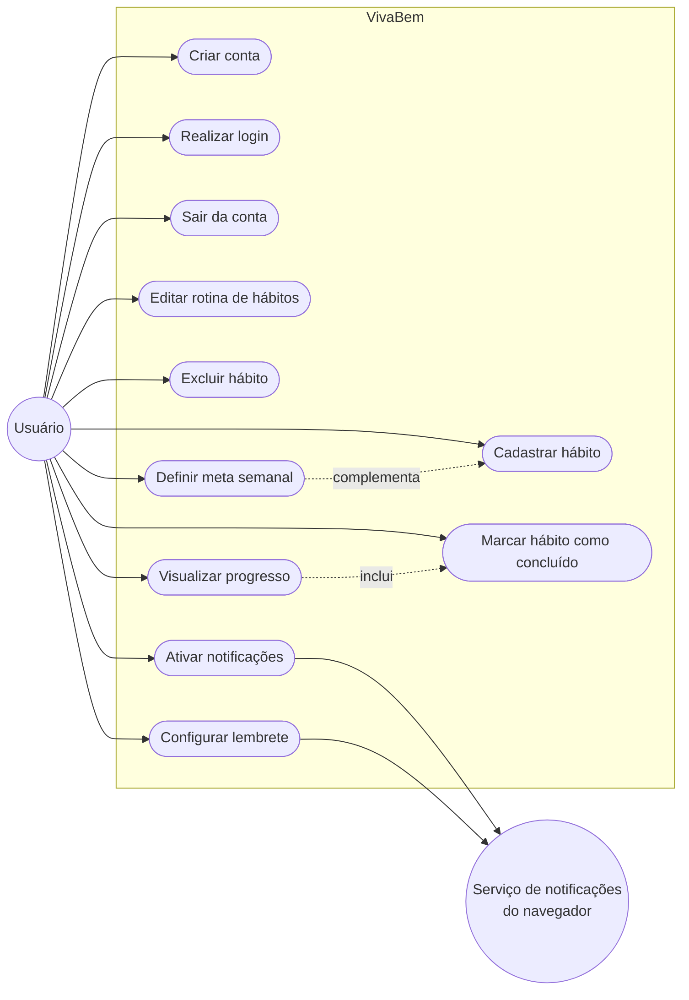
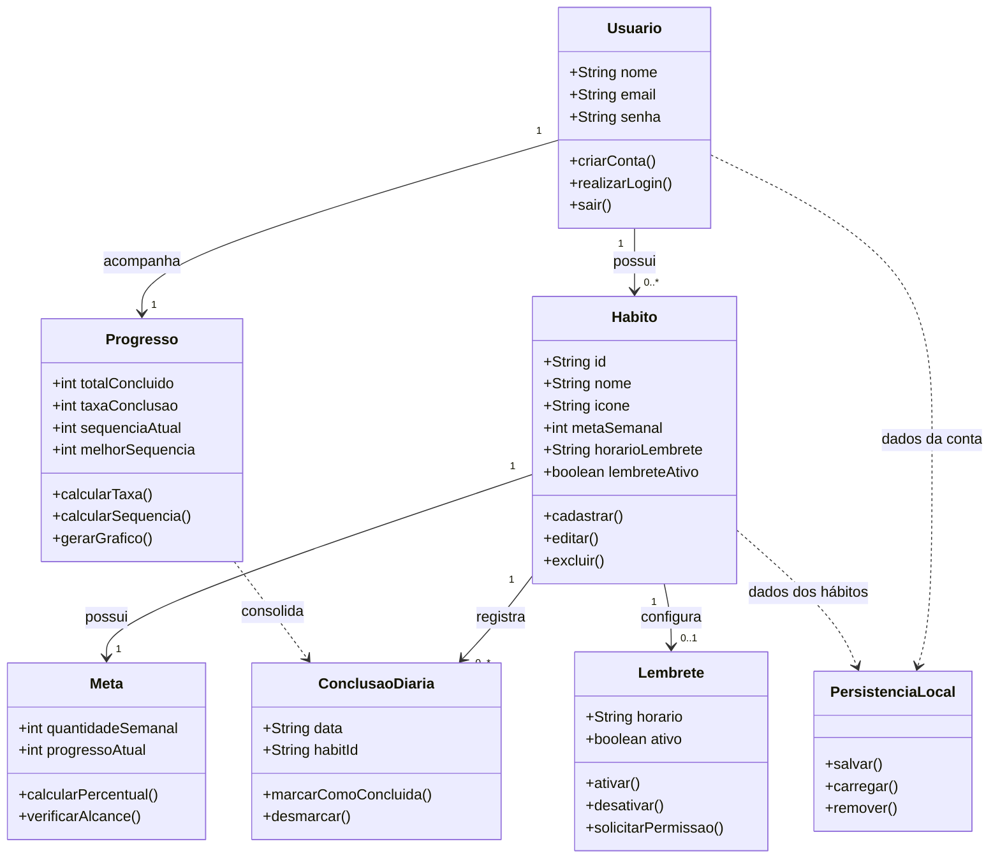

# Diagramas UML — VivaBem

## 1. Diagrama de casos de uso

## 2. Diagrama de classes

## Como visualizar

O arquivo pode ser visualizado no GitHub ou no VS Code com uma extensão que ofereça suporte a Mermaid. Também é possível colar cada bloco em um editor Mermaid compatível para exportar os diagramas como PNG ou SVG.
